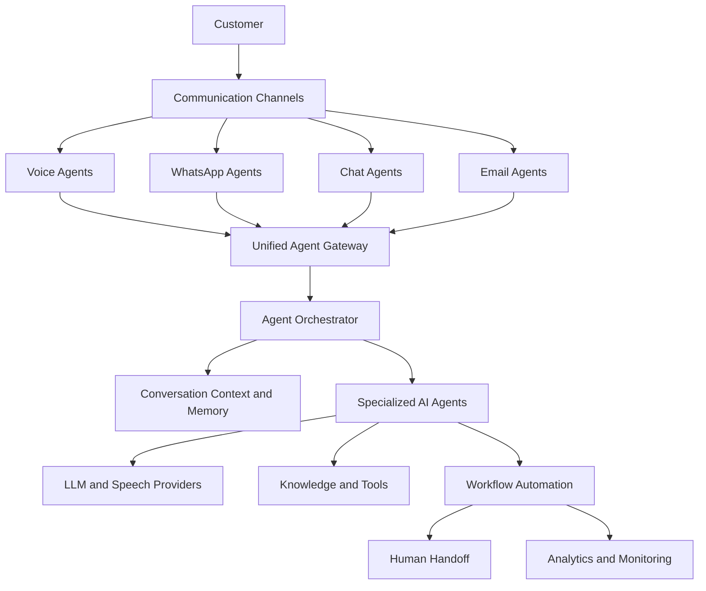

# Multichannel Autonomous AI Communication Platform

### One Platform. Multiple AI Communication Channels.

🚧 **Project Status: Actively Under Development**

## Overview

Multichannel Autonomous AI Communication Platform is designed to provide a unified environment for building, managing, and deploying AI communication agents across multiple channels.

The platform focuses on enabling businesses to automate customer interactions and communication workflows through specialized AI agents that can understand conversations, maintain context, and interact with users.

Rather than creating separate systems for every communication channel, the goal is to bring different AI communication capabilities into one centralized platform.

## Vision

Build an autonomous AI communication ecosystem where businesses can create, configure, deploy, and monitor intelligent agents across voice, chat, WhatsApp, and email.

## Agent Categories

### 1. Voice Agents
AI agents designed for real-time voice communication.

Planned capabilities:
- Inbound and outbound calling.
- Real-time Speech-to-Text.
- AI-powered conversational responses.
- Text-to-Speech generation.
- Call context and conversation history.
- Human handoff and call summaries.

### 2. Chat Agents
AI-powered conversational agents for websites and applications.

Planned capabilities:
- Real-time messaging.
- Context-aware responses.
- Knowledge-based conversations.
- Conversation history.
- Human support escalation.

### 3. WhatsApp Agents
AI agents for business communication through WhatsApp.

Planned capabilities:
- Automated customer conversations.
- Incoming message processing.
- Document and media handling.
- Template-based messaging.
- Human handoff.

### 4. Email Agents
AI agents for business email workflows.

Planned capabilities:
- Email classification.
- Automated response drafting.
- Email summarization.
- Priority and intent detection.
- Human approval workflows.

## Platform Modules

### Agent Management
- Create and configure AI agents.
- Manage agent instructions and capabilities.
- Configure model and provider settings.
- Manage channel integrations.

### Conversation Intelligence
- Conversation context management.
- Memory and history.
- Intent understanding.
- Knowledge-grounded responses.
- Conversation summarization.

### Workflow Automation
- Trigger-based workflows.
- Multi-step agent execution.
- Conversation routing.
- Automated business actions.
- Execution monitoring.

### Human-in-the-Loop
- Human conversation takeover.
- Context-preserving handoff.
- Approval-based actions.
- Operator activity tracking.

### Analytics and Monitoring
- Agent activity tracking.
- Conversation history.
- Channel-level analytics.
- Execution monitoring.
- Error and failure tracking.

## Architecture

## Technology Stack

| Layer | Technologies |
|---|---|
| Backend | Python, FastAPI |
| Frontend | Next.js, React, TypeScript |
| Real-Time Communication | WebSockets, LiveKit, Pipecat |
| Database | PostgreSQL |
| Background Processing | Redis, ARQ |
| Storage | MinIO |
| AI Integration | LLM, STT, TTS APIs |

## Development Roadmap

- [ ] Unified agent management
- [ ] Voice agent configuration
- [ ] Chat agent configuration
- [ ] WhatsApp integration
- [ ] Email integration
- [ ] Conversation context and memory
- [ ] Knowledge-based responses
- [ ] Workflow automation
- [ ] Human handoff
- [ ] Analytics and monitoring
- [ ] Advanced agent orchestration

## Current Development Status

The platform is actively under development. Its agent architecture, channel integrations, conversation workflows, and automation capabilities are being developed incrementally.

Individual modules may have different implementation statuses.

## Long-Term Goal

Create a unified autonomous communication platform that allows businesses to manage intelligent AI employees across their entire communication ecosystem.

## Repository

[View on GitHub](https://github.com/gowthamdangeti/Multichannel-Autonomous-AI-Communication-Platform)
