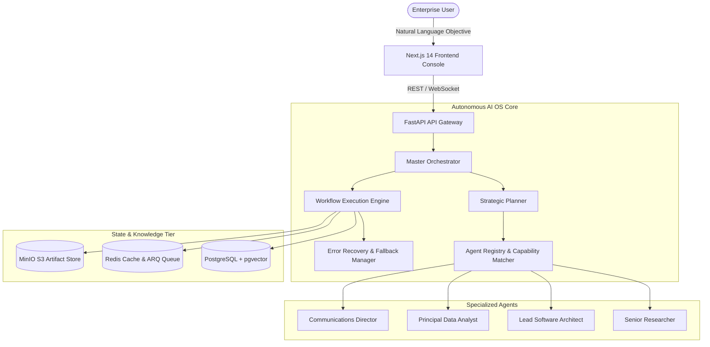

# Autonomous AI OS - Architectural Specification

## 1. System Overview

The Autonomous AI Operating System is structured as a modular monolith backend paired with independent ARQ background workers, an event-driven message mesh, and a Next.js single-page application.

## 2. Core Execution Cycle

1. **User Request**: User inputs high-level goal in natural language.
2. **Understanding & Categorization**: The Strategic Planner extracts domain intent, operational constraints, and risk level.
3. **Planning & Graph Generation**: Constructs an acyclic dependency graph specifying tasks, sequential handoffs, and parallel branches.
4. **Agent Selection**: Discovers matching agents via capability intersection in `AgentRegistry`.
5. **Autonomous Execution**: Standardized Pydantic `TaskContract` payloads are dispatched to agent runtimes.
6. **Verification & Error Recovery**: If confidence is below threshold or exceptions occur, exponential backoff, model fallback, or agent reassignment is triggered.
7. **Human in the Loop**: Sensitive actions (e.g. production deployments, financial actions) block on human signoff.
8. **Delivery & Learning**: Structured results, confidence scores, and documents are stored in MinIO and pgvector.
